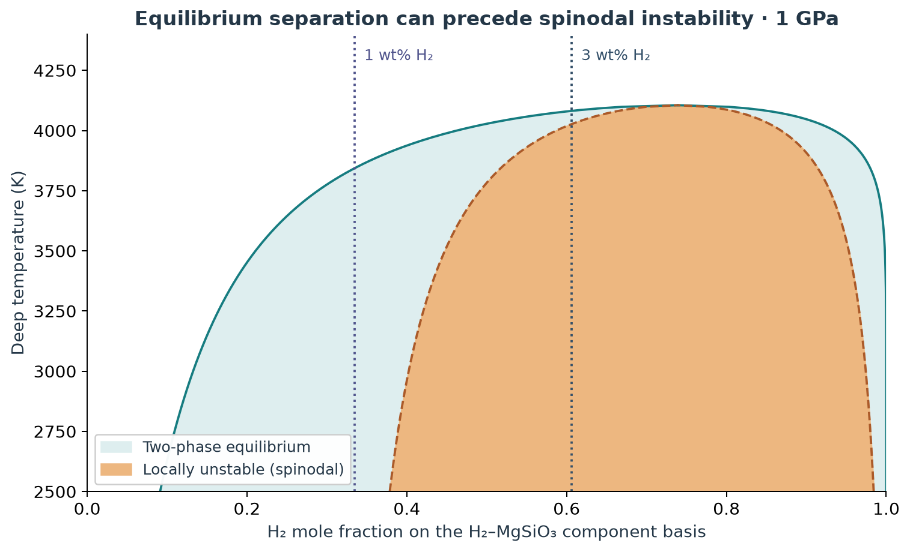
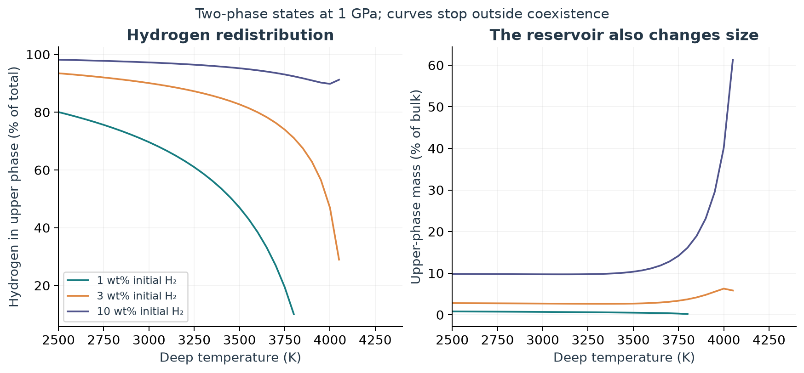
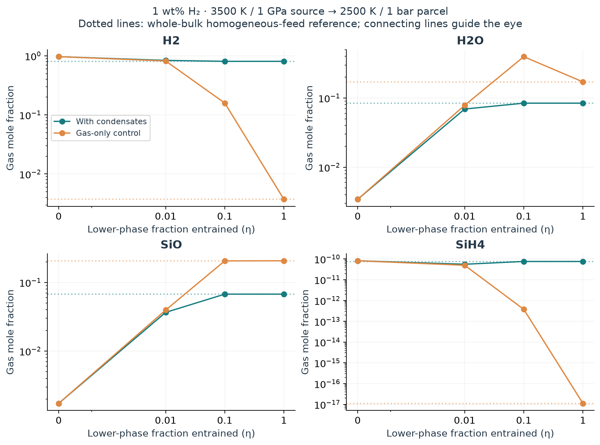

# Does equilibrium demixing change the atmospheric calculation?

The new public API produces a conserved two-phase H₂–MgSiO₃ inventory and can substantially change a subsequent atmospheric calculation **if the separated reservoirs supply different material to it**. The atmospheric signal can also disappear when silicate material is entrained and condensates buffer the gas. These are computed sensitivity results under an explicit transfer prescription, not a self-consistent sub-Neptune atmosphere prediction.

The central scientific distinction is between equilibrium separation and the spinodal instability itself. At 1 wt% H₂, separation occurs in part of the sampled domain while the homogeneous mixture remains locally stable. At 3 wt%, actual spinodal instability occurs. An equilibrium solver alone does not determine the nucleation or transport timescale.

## Use the selector with temperature and composition

This executable example is a **closed binary**, so its component inventories remain fixed while their phase distribution changes:

```python
from atmodeller import ChemicalSpecies, EquilibriumModel, SubregularSolution
from atmodeller.thermodata.defaults import default_properties

model = EquilibriumModel.from_species(
    [],  # closed binary: no reactive gas exchange in this calculation
    temperature=3500.0,
    pressure=10000.0,  # bar = 1 GPa
    mass=0.0,  # every component is explicit; no inert background solvent
    silicate_melt_species=[
        ChemicalSpecies.create_solution("MgSiO3"),
        ChemicalSpecies.create_solution(
            "H2", state="fluid", thermo=default_properties["H2_g"]
        ),
    ],
    mixing_models={
        "silicate_melt": SubregularSolution.hydrogen_silicate_rogers25()
    },
    phase_equilibrium="spinodal",
    mass_constraints={"H2": 0.01, "MgSiO3": 0.99},  # kg
)
demixed = model.solve_with_default().to_dict(to_numpy=True)
homogeneous = model.with_phase_equilibrium("homogeneous").solve_with_default()
warmer = model.update_state(temperature=4400.0, phase_equilibrium="spinodal")
subphases = demixed["silicate_melt"]["phase"]["subphases"]
print(subphases["upper"]["mass"])  # approximately 0.0051104 kg
```

The H₂ gas-reference Gibbs energy contributes only a linear term to this **nonreacting, closed binary**, which cannot alter its coexistence compositions. It is not a calibrated high-pressure fluid endmember for reactive exchange with an atmosphere. The atmospheric stage below uses its own conventional species thermodynamics and receives elemental inventories, not an imposed fluid fugacity.

`"spinodal"` selects common-tangent equilibrium over the entire binodal gap, including metastable compositions. `"homogeneous"` keeps the same nonideal free energy but constrains the binary to one phase. The default `None` preserves existing phase settings. Selecting spinodal treatment without a binary mixing model raises an error. The same selector works in the state factories, `EquilibriumModel.from_state`, the main constructor, and immutable state updates. Mode changes rebuild the compiled solver.

The implementation uses the existing phase/activity interface, conservation equations, Equinox objects and output conventions. There is no separate atmospheric solver. See the [API guide](../../docs/spinodal.rst), [gas-coupling example](../../examples/spinodal_equilibrium.py) and [API tests](../../tests/test_phase_equilibrium_api.py).

## Experiment and provenance

The binary free energy is equation 7 of the [Rogers, Young & Schlichting preprint](https://arxiv.org/html/2509.13320v1#S2.SS1.SSS1), with the published interaction parameters and H₂/MgSiO₃ component basis; the [journal article](https://doi.org/10.1093/mnras/staf1940) provides the publication record. The [Hakim et al. study](https://doi.org/10.1093/mnras/stag133) motivates examining reactive atmospheric chemistry and condensation. Its real-gas H–He–C–N–O–Si model is not reproduced by the narrower experiment here.

| Stage | Inputs and comparison |
|---|---|
| Closed binary | 1 kg bulk; 0.1, 0.3, 1, 3, 5 and 10 wt% H₂; 1, 3, 5 and 10 GPa; 2500–4400 K in 50 K steps |
| Domain filter | Retain `1 − T/4670 − P/350000 > 0` with P in bar, avoiding reversal of the phenomenological excess-energy factor. This is a study choice, not a validation boundary. |
| Matched modes | 738 conditions, each solved homogeneous and demixed: **1,476 native solves** |
| Atmospheric sources | 36 deep parents at 1 GPa, six temperatures and six bulk H₂ fractions |
| Transfer rule | If separated, feed = upper phase + η × lower phase, with η = 0, 0.01, 0.1, 1. Otherwise use the whole parent. The homogeneous reference uses the whole parent. |
| Hot atmospheric parcels | 2300, 2500, 2800, 3000 K; 0.01, 0.1, 1, 10 bar; 13 ideal gases; with and without five condensates: **5,760 solves** |

Each atmospheric feed is normalized to 1 kg for its fixed-temperature/fixed-pressure chemistry solve. Its original available mass is recorded and used to report gas mass per kg of deep bulk. Element ratios, not absolute normalization, set the fixed-pressure gas composition. This is a one-way inventory-transfer experiment: atmospheric reactions do not feed back on the deep free energy, and no planet radius, atmospheric column or pressure profile is solved.

Using the whole parent when no separate upper reservoir exists is a null-control convention, not a continuous transport law across a phase boundary. The temperature sequence must not be interpreted as a planetary cooling track. In single-phase output the whole inventory is assigned to `lower`; the inventory plots therefore stop outside coexistence rather than presenting the change of label as physical loss of hydrogen or mass.

The gas network is H, OH, H₂, H₂O, SiH₄, Mg, MgO, O, SiO, O₂, SiO₂, O₃ and Si. The permitted condensed phases are MgO(s), SiO₂(l), MgSiO₃(l), Mg₂SiO₄(l) and Si(l). All selected parcel temperatures lie inside the thermodynamic data ranges used. The gas-only branch is a deliberately constrained control, not the preferred phase equilibrium wherever condensation is favorable. No liquid silicate data are extrapolated to a cold observable atmosphere.

## Result 1: separation is not synonymous with spinodal decomposition



Across the 738 sampled deep conditions, 376 favor two-phase equilibrium: 274 have negative homogeneous curvature and 102 are metastable. The remaining 362 stay homogeneous. These grid counts are not occurrence probabilities for planets.

| Initial H₂ (wt%) | Two-phase equilibrium | Locally spinodal | Metastable |
|---:|---:|---:|---:|
| 0.1 | 0 | 0 | 0 |
| 0.3 | 20 | 0 | 20 |
| 1 | 75 | 0 | 75 |
| 3 | 93 | 89 | 4 |
| 5 | 95 | 95 | 0 |
| 10 | 93 | 90 | 3 |

There is an analytic explanation. Writing `F = 1 − T/C + P/D`, the homogeneous curvature is

```
g''(x) = RT/[x(1−x)] + F [2B − 4A + 6(A−B)x].
```

For positive T and F ≥ 0, both terms are nonnegative whenever

```
x ≤ (2B−4A)/[6(B−A)] = 0.3359671488,
```

equivalent to **1.005765947 wt% H₂** on this component basis. Thus 1 wt% (`x = 0.3346727424`) cannot become spinodally unstable in this regime, even if equilibrium separation lowers its free energy. This threshold belongs to the chosen parameterization; it is not a measured universal hydrogen abundance. In particular, the many displayed digits are numerical, not calibration precision.

For 3, 5 and 10 wt% H₂ at 1 GPa, the analytic local instability onsets are approximately 4027, 4104 and 4039 K respectively. Metastable separation requires finite-amplitude nucleation; the present calculation assumes the equilibrium endpoint is accessible and does not calculate a barrier.

## Result 2: the atmosphere's source reservoir changes markedly

At **3500 K and 1 GPa**, the coexisting H₂ component mole fractions are 0.210568 and 0.998248. For the same endpoints, the lever rule changes the phase amounts with bulk composition:

| Initial H₂ | Homogeneous state | H₂ in upper phase | Silicate in upper phase | Upper-phase mass / bulk | Free-energy reduction |
|---:|---|---:|---:|---:|---:|
| 1 wt% | Metastable | 46.996% | 0.04150% | 0.51104% | 27.92 kJ/kg bulk |
| 3 wt% | Spinodally unstable | 82.720% | 0.2237% | 2.6986% | 249.15 kJ/kg bulk |

The Gibbs-energy reduction is not latent heat or a decomposition rate. Both separated inventories sum to the original component and total masses; separation creates no extra hydrogen. At 1 wt%, the original Si/H atomic ratio is 0.993997 and the upper-phase ratio is 0.000877760, a reduction of about 1,132-fold. The upper branch's composition at fixed T and P is independent of bulk abundance while the bulk lies inside the coexistence gap; its **amount** is not.



## Result 3: large compositional effects can be buffered away

Take the **1 wt%, 3500 K / 1 GPa source** and equilibrate its selected feed at **2500 K and 1 bar**, allowing the listed condensates. These are gas mole fractions, except the mass row:

| Quantity | Whole-bulk homogeneous feed | Upper phase only (η=0) | η=0.01 | η=0.1 |
|---|---:|---:|---:|---:|
| H₂ | 0.80765 | 0.96831 | 0.83731 | 0.80765 |
| H₂O | 0.084219 | 0.0034353 | 0.069303 | 0.084219 |
| SiO | 0.067502 | 0.0017270 | 0.036580 | 0.067502 |
| SiH₄ | 7.558×10⁻¹¹ | 8.169×10⁻¹¹ | 5.546×10⁻¹¹ | 7.558×10⁻¹¹ |
| Mean molar mass (g/mol) | 6.5827 | 2.1574 | 5.3932 | 6.5827 |
| Gas mass (kg/kg deep bulk) | 0.036144 | 0.0051104 | 0.013845 | 0.018902 |

Upper-only transfer lowers H₂O by **24.5-fold** and SiO by **39.1-fold**. But just 1% lower-phase entrainment reduces those changes to factors of 1.22 and 1.85. With 10% entrainment the condensed assemblage buffers the gas back to its reference composition, while gas mass remains only about 52% of the reference. Composition and available gas mass therefore answer different questions. At 3 wt% the same upper-only gas composition is obtained, but more silicate entrainment is required to erase the effect: at η=0.1, H₂O and SiO are still about 0.877 and 0.721 times their reference values.



Across the 320 atmospheric conditions fed from an actually separated source, H₂, H₂O and SiO simultaneously recover their reference mole fractions within 10⁻⁶ relative error in 9 cases at η=0, 23 at η=0.01, 80 at η=0.1 and all 320 at η=1. The complete-remixing and no-separation controls agree within a maximum absolute log abundance ratio of 3.36×10⁻¹², including SiH₄. These are matched controls, not additional evidence that the imposed entrainment law describes a planet.

Silane is a useful caution. In the example it changes by only 8%, despite the large SiO reduction. At fixed T and P, `SiO + 3 H₂ ⇌ SiH₄ + H₂O` requires

```
SiH4_ratio = SiO_ratio × H2_ratio³ / H2O_ratio.
```

The increased hydrogen abundance and reduced water abundance offset silicon depletion. If condensation is forbidden, the same comparison appears to enhance SiH₄ by 7.27 million-fold, starting from approximately 10⁻¹⁷. Allowing condensates reduces that apparent enhancement to 1.081-fold, with both abundances around 10⁻¹⁰. Neither huge ratios from trace denominators nor these hot-parcel values establish observability. This experiment contains no carbon and cannot establish a SiH₄/CH₄ diagnostic.

## Numerical checks and limits of the claim

All **7,236 primary solves** passed success, mass-conservation and reaction-equilibrium checks. The atmospheric checks explicitly include nonnegative stability multipliers and condensate complementarity: an absent condensate need not satisfy the equality for a present pure phase. Maximum relative elemental error is 1.34×10⁻¹⁵; maximum absolute dimensionless reaction residual is 7.11×10⁻¹⁴. The analysis additionally checks component recovery by the lever rule, non-increasing Gibbs energy, and complete-remixing/no-separation controls. A separate [numerical cross-check](numerical_crosscheck.json) re-solves a subset with perturbed amounts and stability variables and tolerances tightened from 10⁻¹⁰ to 10⁻¹². Software checks and their precise scope are recorded in [validation.json](validation.json).

The deep fit is phenomenological and binary. It omits He, H₂O, Fe and other components that can change the phase diagram. There is no uncertainty distribution for its parameters here. The atmospheric stage is ideal-gas, limited to hot parcels and the listed phases, without rainout, cloud transport, quenching, escape, irradiation or spectral calculations. The binary solution is assumed present; collective phase appearance/disappearance remains unimplemented. No mobility, gradient-energy coefficient, density model or cooling/transport timescale is inferred from the phase boundary.

**Research judgment:** the extension is useful now for computing equilibrium reservoir inventories, diagnosing metastability versus spinodal instability, and testing whether a proposed atmospheric signature survives transfer and condensation controls. A strong next thesis question is: *under which transport and phase-buffering conditions does hydrogen–silicate separation leave an atmospheric chemical signal?* To turn it into a planetary prediction, first establish compatible reacting endmember standard states and additional-component partitioning, then constrain transfer/cooling timescales. A Cahn–Hilliard calculation becomes justified once mobility and gradient-energy inputs can be bounded; adding it alone would not resolve the atmospheric coupling uncertainty revealed here.

## Reproduce and inspect

Run from the repository root:

```sh
uv sync --locked --all-extras --dev
uv run python research/spinodal_study/run_study.py
uv run python research/spinodal_study/analyze_study.py
uv run python research/spinodal_study/verify_study.py --resolve
```

For a short pilot, use `--quick --output /tmp/atmodeller-spinodal-pilot` on `run_study.py`. The main analysis intentionally reads the full archived grid. `--stage deep` and `--stage atmosphere` allow separate stages; the latter reads the existing `deep.json` in the selected output directory.

The [raw outputs and provenance](outputs/) include all cases, phase inventories, solver solutions, residuals, source hashes and a locked-environment hash. [summary.json](outputs/summary.json) and CSV tables contain the derived quantities. Figures are exported as PNG, SVG and PDF. [verify_study.py](verify_study.py) without `--resolve` checks the recorded source/data hashes and accepted flags without rerunning the numerical solves. Provenance records the pre-commit Git parent plus dirty state; the complete source hashes identify the actual implementation used. Later analysis and validation files have their own hashes in `validation.json`.

The earlier [hydrogen-storage study](../hydrogen_storage/investigation/report.html) remains an unchanged historical sensitivity experiment. None of its solubility multipliers are used as spinodal physics in these new runs.
